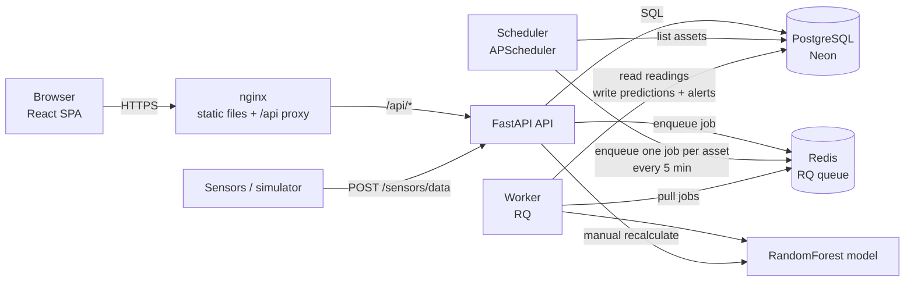
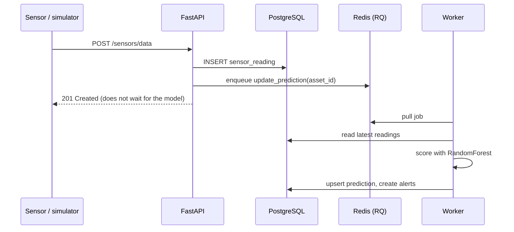
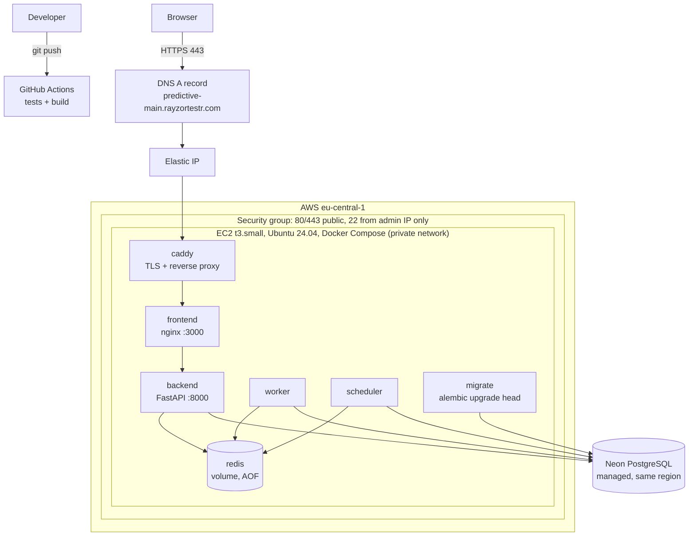

# Predictive Maintenance Platform


A full-stack platform that turns raw sensor readings from industrial equipment into **failure predictions, alerts and maintenance recommendations**, so a maintenance team can fix machines *before* they break instead of after.

Built by **[Francis Eze](https://github.com/BjornOnGit)** · [LinkedIn](https://www.linkedin.com/in/eze-francis-ogonnaya) · fhrancorey99@gmail.com

<!-- Add after the EC2 deployment is verified:
**Live demo:** https://predictive-main.rayzortestr.com
-->

<!-- Add screenshots to docs/screenshots/ and link them here: dashboard, equipment, asset details, alerts, reports -->

---

## Why I built this

Unplanned downtime is expensive, and most small plants either react to breakdowns or service machines on a fixed calendar whether they need it or not. I wanted to build the smallest *honest* version of the alternative: ingest sensor data, estimate each machine's failure risk, and surface the machines that need attention first.

The first version of this project worked, but I wasn't happy with it: secrets were committed, the ML model ran inside the HTTP request, the schema had no migrations, and nothing was tested or deployable. This repository is the version I'd be comfortable running for real. The [Evolution](#evolution-what-i-changed) section lists exactly what changed and why, because the decisions are the point of the project.

## What to look at first

| If you care about… | Look at |
|---|---|
| Architecture & async design | [System architecture](#system-architecture), `backend/app/worker/`, `backend/app/core/queue.py` |
| Infrastructure & deployment | [Infrastructure architecture](#infrastructure-architecture), `docker-compose.prod.yml`, `Caddyfile` |
| Data & ML | [The model](#the-model-and-its-limits), `backend/app/ml/` |
| Engineering practice | [Testing and CI](#testing-and-ci), `backend/alembic/`, `.github/workflows/ci.yml` |
| Product / frontend | `frontend/src/pages/`, `frontend/src/components/` |
| Judgement and trade-offs | [Technical decisions](#technical-decisions-and-trade-offs), [What I'd add next](#what-i-would-add-with-more-time) |

## Features

- **Equipment registry** with live health score, risk level and status per asset
- **Sensor ingestion** (vibration, temperature, pressure, runtime hours, RPM) via API or manually from the UI
- **Failure prediction** with a scikit-learn model, computed asynchronously by background workers
- **Alerts** with severity, a detail panel and acknowledge workflow
- **Maintenance logging** and rule-based recommendations per asset
- **Reports**: health scorecard, maintenance forecast, alert trends and CSV exports
- **Role-based access**: `viewer` is read-only; `engineer` / `admin` can write
- **Dashboard** with fleet health, risk distribution and recent alerts

**Stack:** FastAPI · SQLAlchemy 2 · Alembic · PostgreSQL (Neon) · Redis + RQ · scikit-learn · React 19 · Vite · Tailwind v4 · shadcn/ui · Recharts · Docker Compose · Caddy · GitHub Actions

---

## Quick start (local)

**Prerequisites:** Docker with Compose v2, and a PostgreSQL database URL (a free [Neon](https://neon.tech) project works; any Postgres does).

```bash
git clone https://github.com/BjornOnGit/predictive-maintenance-platform.git
cd predictive-maintenance-platform

cp backend/.env.example backend/.env
# edit backend/.env: set DATABASE_URL (postgresql+psycopg2://...) and SECRET_KEY
#   generate a key with:  openssl rand -hex 32

docker compose up --build
```

Open **http://localhost:3000**. Containers started: `migrate` (runs once), `backend`, `worker`, `scheduler`, `redis`, `frontend`.

### First login and roles

New accounts are `viewer` (read-only) by design. Register in the UI, then promote yourself in the database:

```sql
UPDATE users SET role = 'admin' WHERE email = 'you@example.com';
```

The role is read from the database on every request, so there is no need to log in again.

### Generate demo data

The simulator posts readings as a user named `simulator@example.com` (password `simulator123`). Register that user, promote it to `engineer`, then:

```bash
docker compose exec backend python -m app.utils.simulator            # healthy equipment
docker compose exec backend python -m app.utils.simulator --failure  # degrading equipment
```

Within seconds the worker produces predictions and, for degrading equipment, alerts.

### Useful commands

```bash
docker compose logs -f worker          # watch prediction jobs run
docker compose run --rm --no-deps backend alembic check   # migrations match the models?
```

API docs (Swagger) are served by FastAPI at `http://localhost:8000/docs`.

---

## System architecture

How the services talk to each other:



**Lifecycle of a sensor reading** (the central design decision of the project):



**Why it looks like this:** ingestion latency must not depend on inference time, and a prediction run must never block or crash an API request. If Redis is down, the reading is still saved and the API returns `201`; the scheduler's 5-minute fan-out catches up afterwards. A test in the suite covers exactly this case.

**Alert lifecycle.** Every prediction run (a new reading, the scheduler's 5-minute sweep, or a manual recalculate) checks the latest readings and risk level against thresholds and may raise an alert. An alert is created only if none of the same type is already open for that asset, **or was acknowledged within the last hour** (`ALERT_COOLDOWN`). Acknowledging therefore means "I know about this": the alert stays quiet while the underlying condition persists, and re-raises as a reminder after the cooldown if it hasn't been fixed. A resolved condition raises a new alert only when it triggers again.

**Components**

| Service | Responsibility |
|---|---|
| `frontend` | nginx serving the React build; proxies `/api/*` to the backend so the browser only ever talks to one origin (no CORS, no hard-coded URLs) |
| `backend` | FastAPI: auth, CRUD, ingestion, reports. Enqueues work, never does heavy work itself |
| `worker` | Consumes prediction jobs; the only place the ML model runs besides the explicit "Recalculate" button |
| `scheduler` | A single process that enqueues one prediction job per asset every 5 minutes |
| `redis` | Job queue (append-only persistence enabled) |
| `migrate` | One-shot container running `alembic upgrade head` before the API starts |
| PostgreSQL | System of record (managed by Neon) |

---

## Infrastructure architecture

The whole stack runs on a single EC2 instance with Docker Compose. Only Caddy is reachable from the internet.



**How the EC2 instance talks to the queue and everything else**

- All containers share one Docker bridge network (`predictive-net`). Services reach each other by name: the API and scheduler connect to `redis://redis:6379/0`, the worker consumes from the same Redis, and the frontend proxies to `backend:8000`.
- **Redis, the backend and the worker publish no ports.** The production overlay (`docker-compose.prod.yml`) strips the published ports from `backend` and `frontend`; only Caddy binds 80 and 443.
- The security group allows 80/443 from anywhere and SSH only from the administrator's IP.
- The database is outside the instance (Neon), reached over TLS. Containers use a small SQLAlchemy connection pool with `pool_pre_ping` because serverless Postgres drops idle connections.
- An **Elastic IP** keeps the address stable across restarts, and a DNS A record points the domain at it. Caddy obtains and renews the Let's Encrypt certificate automatically.
- Secrets live in untracked `.env` files on the instance, never in the repository or the images.

**Deploying**

```bash
# one-time, on a fresh Ubuntu 24.04 instance
bash deploy/setup-ec2.sh          # 2 GB swap + Docker; log out and back in afterwards

# create backend/.env (DATABASE_URL, SECRET_KEY, ...) and a root .env with DOMAIN=your.domain
docker compose -f docker-compose.yml -f docker-compose.prod.yml up -d --build

# update later
git pull && docker compose -f docker-compose.yml -f docker-compose.prod.yml up -d --build
```

---

## Technical decisions and trade-offs

Every choice below was made for a reason and has a cost. I've tried to be honest about both.

### Backend and data

| Decision | Why | Trade-off |
|---|---|---|
| **FastAPI + sync SQLAlchemy** | Simple, readable, great validation and OpenAPI docs. The slow work (inference) is CPU-bound and moved to workers, so async I/O would add complexity for little gain | Fewer concurrent requests per process than a fully async stack |
| **Redis + RQ for the job queue** | Runs identically on a laptop and on EC2 with no cloud account or IAM; tiny operational footprint | Less durable than SQS (mitigated with append-only persistence); delivery is at-least-once, so jobs are written to be idempotent. SQS + dead-letter queue is the upgrade path |
| **Scheduler as its own container** | Exactly one scheduler regardless of how many API processes run; previously an in-process scheduler would have fired once per API worker | One more container |
| **One job per asset (fan-out)** | Jobs run in parallel across workers (`--scale worker=3`), and one failing asset doesn't block the others | More jobs; bursts of readings can enqueue redundant runs for the same asset (harmless but wasteful) |
| **Cooldown after acknowledging an alert** | Predictions re-run constantly, so without a cooldown an acknowledged alert was re-created within minutes while the condition persisted, and the open-alert count never went down (alert fatigue) | A genuinely worsening condition stays quiet for up to an hour after acknowledgement. The window is one constant; a per-severity or per-type window, or escalation on worsening, would be the refinement |
| **PostgreSQL on Neon** | Relational data with foreign keys fits the domain; managed, no database administration | Network hop to the database; DB sits outside the VPC. Amazon RDS would be the production choice |
| **Alembic migrations (not `create_all`)** | Schema is versioned and reviewable; CI runs `alembic check` so models and migrations cannot drift | An extra moving part, and a one-time `stamp` step for databases that predate it |
| **Tests run on real PostgreSQL** | The schema uses PostgreSQL types and the migrations are exercised for real | Slower than SQLite, but it catches what mocks hide |
| **Pinned dependencies** | An unpinned rebuild once silently changed the default database driver and broke the app | Direct dependencies only; a full lockfile (`uv` / `pip-tools`) would also pin transitive ones |

### ML

| Decision | Why | Trade-off |
|---|---|---|
| **Random forest on four tabular features** | Small, fast, no GPU, handles non-linear interactions and needs little tuning | No temporal modelling; it scores the latest readings, not the trend |
| **Synthetic, seeded training data** | I have no real fleet data; a generator makes the model reproducible and lets CI build it from scratch | Metrics describe how well the model recovers *simulated* behaviour, not real-world accuracy (see below) |
| **Train at image build time** | No model binary in git; the scikit-learn version used to train is guaranteed to match the one that serves | Image builds are a little slower |

### Security

| Decision | Why | Trade-off |
|---|---|---|
| **JWT bearer tokens + roles** | Stateless and simple; role checks are a single FastAPI dependency (`require_role`) | Tokens are stored in `localStorage` (exposed to XSS) and there is no refresh or revocation |
| **Open registration, `viewer` by default** | Anyone can explore the app safely; privilege requires an explicit grant | Promotion is a SQL statement; there is no admin UI yet |
| **Same-origin `/api` proxy** | No CORS surface and no environment-specific URLs baked into the JS bundle | One extra hop through nginx |
| **Secrets only in env files** | Nothing sensitive in git or images; a leaked credential in an earlier version was rotated | Manual secret management on the instance |

### Frontend

| Decision | Why | Trade-off |
|---|---|---|
| **React + Vite SPA, not Next.js** | A dashboard behind a login needs no SEO or server rendering; Next.js would add a server runtime for no user benefit | No SSR |
| **Tailwind + shadcn/ui** | Accessible Radix primitives whose source lives in the repo, so I own and can change every component | More files in the repository than a packaged UI library |
| **Recharts + zustand + axios** | Small, well-known, easy to read | A data-fetching library (TanStack Query) would remove hand-written loading and error state |

### Infrastructure

| Decision | Why | Trade-off |
|---|---|---|
| **Single EC2 + Docker Compose** | Right-sized for the load, cheap, and every moving part is visible in one file | One instance is a single point of failure and there is no autoscaling. ECS/Fargate behind an ALB is the next step |
| **Caddy for TLS** | Automatic certificate issuance and renewal in four lines of config | An ALB + ACM setup would be more "AWS-native" but costs more and adds infrastructure |
| **Compose overlay for production** | Local development keeps its published ports; production exposes only Caddy | Two compose files to keep in sync |
| **Non-root containers, unprivileged nginx** | Smaller blast radius if a container is compromised | Slightly more care with ports and file permissions |

---

## The model and its limits

- **Features:** vibration, temperature, pressure, runtime hours
- **Algorithm:** `RandomForestClassifier` (100 trees, max depth 10, balanced class weights), with a stratified train/test split
- **Output:** failure probability, mapped to a `Low` / `Medium` / `High` risk level, plus a health score

**Data.** `backend/app/ml/generate_data.py` produces 5,000 seeded rows from three simulated machine populations (healthy, degrading, failing). Failure odds rise with each feature, plus noise so the problem is not trivially separable. The model is trained during the Docker build and the metrics are written to `models/metrics.json`.

| Metric (held-out 20%) | Value |
|---|---|
| Accuracy | 0.949 |
| Precision | 0.844 |
| Recall | 0.849 |
| ROC-AUC | 0.977 |

**Read these numbers carefully.** They show the model recovers the *simulated* failure behaviour. They say nothing about real-world accuracy, because there is no real data here. An earlier version trained on 30 rows and reported a meaningless accuracy from a 6-row test set; I kept the synthetic approach but made it reproducible, larger and honest about what it measures. With real data, the pipeline stays the same and only the data source changes.

---

## Roles and permissions

| Action | viewer | engineer | admin |
|---|:-:|:-:|:-:|
| View equipment, readings, predictions, alerts, reports | ✅ | ✅ | ✅ |
| Create equipment | ❌ | ✅ | ✅ |
| Post sensor readings, log maintenance | ❌ | ✅ | ✅ |
| Acknowledge alerts, recalculate predictions | ❌ | ✅ | ✅ |

`admin` currently has the same powers as `engineer`; user management is on the roadmap.

## API overview

| Prefix | Purpose |
|---|---|
| `/auth` | register, login |
| `/assets` | equipment CRUD |
| `/sensors` | post readings, reading history |
| `/predictions` | per-asset and fleet predictions, manual recalculate |
| `/alerts` | open alerts, acknowledge |
| `/maintenance` | maintenance logs, recommendations |
| `/analytics` | health report, alert trends, prediction summary |
| `/reporting` | scorecard, maintenance forecast, CSV exports |

Full interactive documentation: `/docs` on the backend.

## Testing and CI

- **Backend:** pytest against a real PostgreSQL database. Covers the ML model, authentication and role enforcement, the sensor → prediction flow (including graceful behaviour when Redis is unavailable) regression tests for the analytics and CSV endpoints, and alert behaviour (an acknowledged alert is not re-created straight away).
- **CI** ([`.github/workflows/ci.yml`](.github/workflows/ci.yml)), on every push and pull request:
  1. Backend: start Postgres → `alembic upgrade head` → `alembic check` (models and migrations must agree) → train the model → run tests
  2. Frontend: `npm ci` → `npm run build`

Run the tests locally against a throwaway database (never your real one):

```bash
docker run -d --rm --name pgtest -e POSTGRES_PASSWORD=pg -p 5433:5432 postgres:16-alpine
docker compose build backend
docker run --rm --network host -v "$PWD/backend/tests:/app/tests:z" \
  -e SECRET_KEY=test \
  -e DATABASE_URL=postgresql+psycopg2://postgres:pg@localhost:5433/postgres \
  predictive-maintenance-platform-backend \
  sh -c "pip install -q pytest httpx && alembic upgrade head && python -m pytest -q"
docker stop pgtest
```

## Project structure

```
backend/
  alembic/            migrations
  app/
    api/routes/       auth, assets, sensors, predictions, alerts, maintenance, analytics, reporting
    core/             config, database, security, queue, scheduler
    ml/               data generator, training, prediction
    models/           SQLAlchemy models
    schemas/          Pydantic schemas
    services/         prediction, scoring, alerting, recommendations
    worker/           RQ worker entrypoint and job functions
    utils/simulator.py   demo sensor data
  tests/
frontend/
  src/pages/          Dashboard, Assets, AssetDetails, Alerts, Reports, Login
  src/components/     layout, sidebar, alert panel, reusable dialog, shadcn/ui
docker-compose.yml          local stack
docker-compose.prod.yml     production overlay (Caddy, no public app ports)
Caddyfile
deploy/setup-ec2.sh
.github/workflows/ci.yml
```

---

## Evolution: what I changed

| Problem in the first version | What I did |
|---|---|
| Database credentials and signing key committed in `docker-compose.yml`; `.env` copied into the image | Moved to untracked env files, removed the fallback key (the app now refuses to start without one), rotated every credential |
| Analytics and CSV export endpoints returned 500 (wrong column names, duplicate model) | Fixed, removed the duplicate model, added regression tests |
| Model trained on 30 rows with a 6-row test set; simulator data outside the training range | Seeded 5,000-row generator, stratified split, real metrics, simulator ranges covered |
| Predictions computed inside the HTTP request; in-process scheduler | Redis queue, worker and a dedicated scheduler container |
| `create_all` on startup | Alembic migrations, a one-shot `migrate` service, and `alembic check` in CI |
| Anyone could create equipment; CORS open to all origins | Role-based access (`viewer` by default), CORS restricted to configured origins |
| Acknowledged alerts reappeared within minutes, so the open-alert count never dropped | Added a cooldown after acknowledgement and a regression test for it |
| Frontend could not reach the API from Docker; unused backend routes | nginx same-origin proxy; UI now covers sensor posting, maintenance, recommendations, reports and CSV export |
| Generic UI | shadcn/ui, collapsible sidebar, clickable alerts with a detail panel, modal forms, charts built on real data |
| No tests, no CI, unpinned dependencies, Python 3.10 | pytest on real Postgres, GitHub Actions, pinned versions, Python 3.12 |
| No deployment story | EC2 + Compose + Caddy with automatic HTTPS |

---

## What I would add with more time

**Data and ML**
- Real ingestion path (MQTT or AWS IoT Core → Kinesis) with per-device API keys instead of user tokens
- Time-series storage (TimescaleDB) with downsampling, so the dashboard can show real trends
- Time-aware features (rolling means, rates of change) and a remaining-useful-life regression model
- Model registry and monitoring: MLflow, drift detection, scheduled retraining, SHAP explanations for each prediction

**Reliability and scale**
- Per-asset job de-duplication and retry/back-off; SQS with a dead-letter queue
- Infrastructure as code (Terraform) and automated deployment from GitHub Actions
- Managed Postgres in the VPC (RDS Multi-AZ), automated backups, ECS/Fargate behind an ALB for zero-downtime deploys and autoscaling
- Structured logging, metrics (Prometheus/Grafana), error tracking (Sentry), readiness probes, an RQ dashboard

**Security**
- httpOnly cookie sessions with refresh tokens, login rate limiting, password reset
- A user-management screen and distinct admin capabilities, an `/auth/me` endpoint, audit logging

**Product**
- Smarter alerting: per-type cooldowns, escalation when a condition worsens after acknowledgement, and resolve-on-recovery
- Alert notifications (email, Slack) and live updates via SSE or WebSockets
- Pagination and sorting on large tables; TanStack Query for data fetching
- A `notes` field on maintenance logs (needs a new migration)

**Engineering hygiene**
- TypeScript on the frontend, ESLint in CI, Playwright end-to-end tests
- Pydantic v2 `ConfigDict` / `model_dump`, timezone-aware datetimes (the test run currently emits deprecation warnings for both)
- A local Postgres service in Compose for a zero-configuration quick start
- A full dependency lockfile, and Swagger served correctly under the `/api` prefix

---

## Author

Built and maintained by **[Francis Eze](https://github.com/BjornOnGit)**. Questions, feedback or collaboration: fhrancorey99@gmail.com.